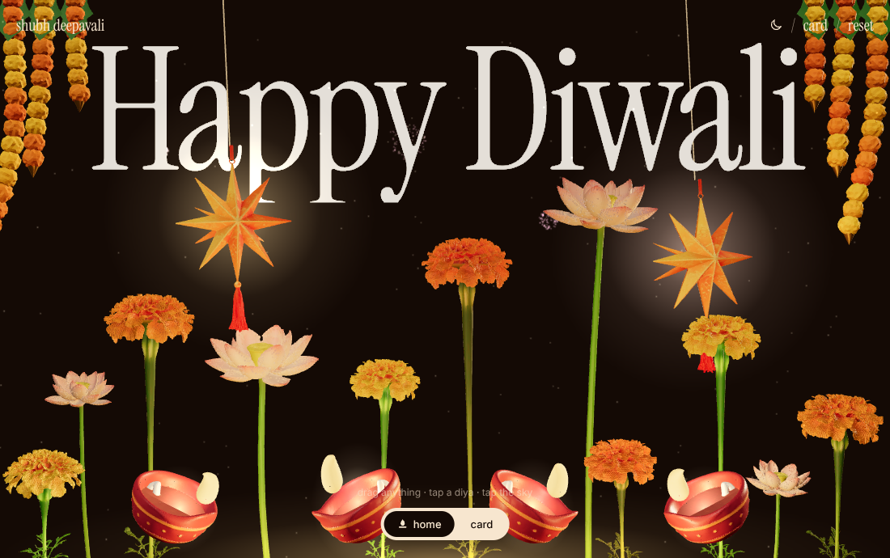
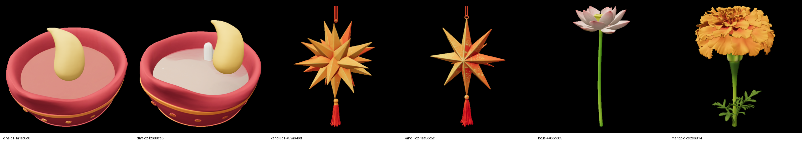

# Happy Diwali — a 3D greeting you can play with

An interactive Diwali greeting that runs in the browser. Clay diyas, akash kandils, marigolds and lotuses stand around giant "Happy Diwali" type, and everything reacts when you touch it. Flip it into a card, write your own message, send the link.

## What you can do

- **Drag anything.** Each object picks up a rotating 3D frame, turns with your hand and tilts in the direction you move it.
- **Click an object** to spin it a full turn. At night, clicking a diya lights it or puts it out.
- **Drag empty space** to turn the whole scene. It coasts, then settles back to the front view.
- **Watch the physics.** Kandils and garlands swing like pendulums, stems bend and spring back, diyas rock, and flames lean away from the turn.
- **Tap the sky** at night for fireworks.
- **Switch day and night.** At night the diyas come out and the kandils glow. By day there are no diyas and nothing is lit.
- **Open the card.** The scene shrinks into a card over big "SHUBH DEEPAVALI" type. Flip it to edit the message and the To and From names. Edits and dragged positions are saved in the visitor's browser.

| Night | Day |
|---|---|
|  |  |

## How it's made

- **3D models:** generated with the [Tripo](https://www.tripo3d.ai) CLI. The diya comes from a reference image; the kandil, marigold and lotus come from text prompts. Each raw model was around 40 MB, so they were simplified to 1.8–3 MB with a custom Python script that keeps UV seams closed and bleeds texture edges.
- **Rendering:** [Three.js](https://threejs.org) r128 with GLTFLoader. Marigold and lotus stems are lengthened per instance by stretching only the stem band of the mesh, so flower heads and leaves keep their shape.
- **Interaction:** spring-damper physics per object, driven by how fast the scene turns. The camera orbits on drag with inertia and settles back to the front view. Clicks are checked against the real mesh, so empty space stays free for turning the scene.
- **Type:** Instrument Serif for display, Inter for UI.
- **Everything in one file:** `index.html` carries the models inline (base64), so it works from a double-click or any static host.

## Run it

Open `index.html` in a browser. It needs an internet connection for Three.js and the fonts.

To host it, turn on **GitHub Pages** for this repo (Settings → Pages → Deploy from branch → `main`, root folder).

## Credits

Built by Shubham Shinde with Claude and Tripo.
